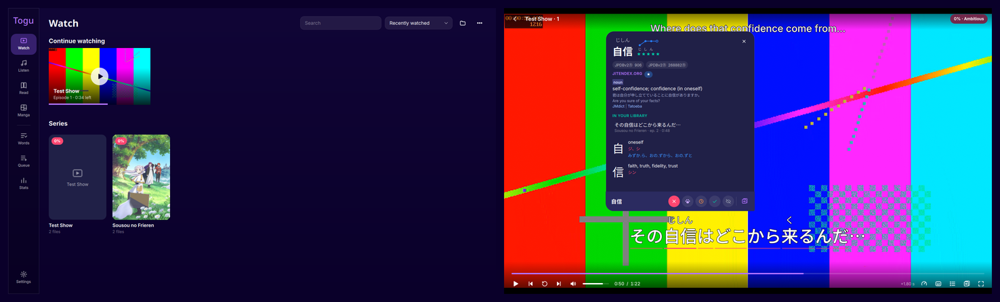

 
 <h1 align="center"> Togu </h1>

*Requires Linux.*

## Download

*Requires Linux with mpv, ffmpeg and Qt 6 (WebEngine included).*

A free and open source Japanese immersion player for your own video, audio, books and manga. Point it at your folders and watch with interactive subtitles, Yomitan dictionary lookups, word statuses (from your Anki decks if you like) and one-key Anki cards with audio and pictures cut straight from the video.

## Issues, Feature Requests and Contributing

Pull requests are welcome. For major changes, please open an issue first to discuss what you would like to change.

Issues

1. **Before reporting a new issue, take a look at the [changelog](https://github.com/mKonic/togu-player/releases) and the already opened [issues](https://github.com/mKonic/togu-player/issues).**

Bugs

* Include version (Settings → General → About)
 * If not latest, try updating, it may have already been solved
* Include steps to reproduce (if not obvious from description)
* Include screenshot (if needed)
* Don't group unrelated requests into one issue

Use the [issues](https://github.com/mKonic/togu-player/issues/new) page to submit a bug.

Feature Requests

* Write a detailed issue, explaining what it should do or how.
* Include screenshot (if needed).

### Disclaimer

The developer(s) of this application does not have any affiliation with the dictionary or metadata providers it downloads from, and this application hosts zero content.

## License

    Copyright 2026 mKonic

    This program is free software: you can redistribute it and/or modify
    it under the terms of the GNU General Public License as published by
    the Free Software Foundation, either version 3 of the License, or
    (at your option) any later version.

    This program is distributed in the hope that it will be useful,
    but WITHOUT ANY WARRANTY; without even the implied warranty of
    MERCHANTABILITY or FITNESS FOR A PARTICULAR PURPOSE.  See the
    GNU General Public License for more details.
